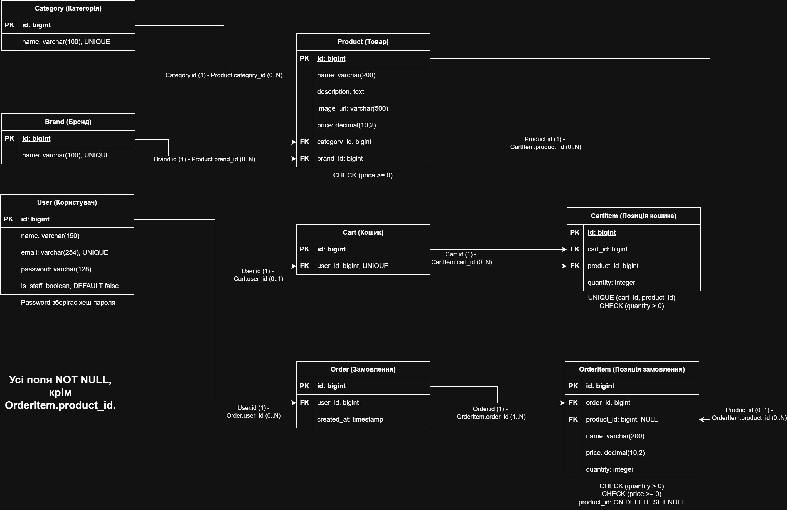

# PaperBox - інтернет-магазин канцелярії

## Ідея проєкту

PaperBox - сайт для перегляду та замовлення канцелярських товарів: зошитів, ручок, олівців, блокнотів та іншого приладдя для навчання й роботи.

Відвідувач може переглядати каталог, знаходити потрібні товари та дізнаватися про них детальніше. Після реєстрації користувач може додавати товари до кошика, оформлювати замовлення та переглядати історію своїх замовлень.

## Поточний стан реалізації

Реалізовано REST API каталогу - товари, категорії і бренди. Для кожного ресурсу доступні створення, перегляд списку та окремого запису, часткове редагування та видалення.

Для товарів реалізовано пошук за назвою, фільтрацію за категорією і брендом, сортування та пагінацію.

Автентифікація, розмежування прав доступу, профіль, кошик, замовлення та ендпоінт інформації про магазин заплановані для наступних етапів роботи. 
На поточному етапі всі реалізовані операції каталогу доступні без входу в обліковий запис.

Опис можливостей і схема бази даних охоплюють повний запланований проєкт. Наразі створено моделі Category, Brand і Product.


## Запуск backend

Команди для Linux або WSL. Потрібні Python, сумісний із залежностями в `requirements.txt`, та Git.

```bash
git clone --branch catalog-api https://github.com/deeptest10/paperbox.git
cd paperbox
python3 -m venv .venv
source .venv/bin/activate
python -m pip install -r requirements.txt
python manage.py migrate
python manage.py runserver 8000
```

API доступне за адресою http://127.0.0.1:8000/api/v1/products/.

Використовується SQLite. Після першого запуску каталог порожній. Щоб додати товар, спочатку створіть категорію та бренд через API або Postman, потім використайте їхні ID під час створення товару.


## Перевірки

Команди виконуються з активованим віртуальним середовищем у папці backend.

```bash
python -m pip install -r requirements-dev.txt
python manage.py check
python manage.py test catalog
python check_submission.py
```

У `catalog/tests.py` є 9 тестових сценаріїв - CRUD, валідація, захист пов'язаних записів, пошук, фільтрація, сортування та пагінація.


## Frontend

Окремий репозиторій: [paperbox-frontend](https://github.com/deeptest10/paperbox-frontend)

Інструкція запуску наведена в README frontend. Сторінка працює на http://127.0.0.1:5500 та отримує товари з backend на порту 8000.

Реалізовано відображення назви, опису та ціни товару, стану завантаження, порожнього каталогу й помилки запиту. Відображається перша сторінка каталогу - до 20 товарів.

У backend налаштовано CORS для `http://127.0.0.1:5500` та `http://localhost:5500`.


## Postman

- [Колекція запитів у форматі v2.1](postman/paperbox.postman_collection.json).
- [Порядок перевірки та налаштування змінних](postman/README.md).


## Основні можливості

Нижче наведено можливості повного запланованого проєкту. Реалізовану частину описано в розділі «Поточний стан реалізації».


### Каталог товарів

- Перегляд списку товарів.
- Пошук товарів за назвою.
- Фільтрація за категорією та брендом.
- Сортування за ціною та назвою.
- Перегляд сторінки товару з його назвою, описом, зображенням, ціною, категорією та брендом.

### Категорії та бренди

- Перегляд списку категорій, наприклад «Зошити», «Ручки» та «Олівці».
- Перегляд товарів вибраної категорії.
- Перегляд списку брендів і товарів вибраного бренду.

### Обліковий запис

- Реєстрація, вхід та вихід з облікового запису.
- Перегляд власного профілю.
- Редагування імені та електронної пошти.
- Перегляд історії власних замовлень і складу кожного замовлення.

### Кошик та замовлення

- Додавання товарів до власного кошика.
- Зміна кількості товару в кошику.
- Видалення товарів із кошика.
- Перегляд загальної вартості товарів.
- Створення замовлення з товарів у кошику.

Оформлювати замовлення можуть лише авторизовані користувачі. Після оформлення замовлення кошик очищується. Створене замовлення зберігає перелік товарів, їхню кількість і ціни на момент оформлення.

У рамках проекта замовлення створюється без онлайн оплати та введення даних доставки.

### Керування каталогом

Адміністратор може додавати, редагувати та видаляти товари, категорії й бренди. Звичайні користувачі не можуть змінювати каталог.

### Інформація про магазин

На сторінці «Про нас» розміщується короткий опис магазину та контактна інформація.


## Структура бази даних



[Вихідний файл схеми для редагування](docs/database-schema.drawio)

База даних містить такі сутності:

| Сутність | Призначення |
|---|---|
| Користувач (`User`) | Зберігає дані облікового запису та ознаку адміністратора. |
| Категорія (`Category`) | Об’єднує товари за типом, наприклад «Зошити» або «Ручки». |
| Бренд (`Brand`) | Зберігає назву бренду, до якого належать товари. |
| Товар (`Product`) | Зберігає назву, опис, посилання на зображення, ціну, категорію та бренд товару. |
| Кошик (`Cart`) | Належить одному користувачу та містить вибрані ним товари. |
| Позиція кошика (`CartItem`) | Пов’язує кошик із товаром і зберігає його кількість. |
| Замовлення (`Order`) | Належить одному користувачу та зберігає дату створення замовлення. |
| Позиція замовлення (`OrderItem`) | Зберігає товар, його кількість, назву та ціну на момент оформлення замовлення. |

### Зв’язки між сутностями

- Одна категорія може містити багато товарів. Кожен товар належить одній категорії.
- Один бренд може мати багато товарів. Кожен товар належить одному бренду.
- Кожен користувач може мати один кошик і багато замовлень.
- Один кошик може містити багато позицій. Кожна позиція належить одному кошику та посилається на один товар.
- Одне замовлення містить одну або більше позицій. Кожна позиція належить одному замовленню.
- Один товар може входити до багатьох позицій різних кошиків і замовлень.

### Основні правила

- Ціна товару не може бути від’ємною.
- Кількість товару в кошику або замовленні має бути додатним цілим числом.
- Повторне додавання товару до кошика збільшує його кількість, а не створює окрему позицію.
- Оформити замовлення з порожнього кошика неможливо.
- Під час оформлення замовлення назви, ціни та кількість товарів зберігаються в його позиціях. Після цього кошик очищується.
- Зміни в каталозі не змінюють дані вже оформлених замовлень.
- Видалення товару прибирає його з кошиків, але зберігає позиції попередніх замовлень. У таких позиціях посилання на товар стає порожнім, а збережені назва, ціна та кількість залишаються.
- Категорію або бренд можна видалити, лише якщо до них не належить жоден товар.
- Паролі користувачів зберігаються у вигляді хешів, а не відкритого тексту.


## REST API

### Загальні правила

- Базовий шлях: `/api/v1/`.
- Формат тіл запитів і відповідей - JSON. Для запитів із тілом використовується `Content-Type: application/json`.
- `{id}` у шляху означає ідентифікатор запису.
- Для часткового редагування використовується `PATCH`.
- Ціни вказуються у гривнях і передаються рядками, наприклад `"25.00"`.
- На поточному етапі всі операції з товарами, категоріями та брендами доступні без автентифікації.
- Обмеження змін каталогу правами адміністратора буде додано разом з авторизацією.
- Правила доступу до власного профілю, кошика та замовлень описують заплановану поведінку наступних етапів.
- Механізм автентифікації буде уточнено під час реалізації (`TBD`).


### Формат помилок

Реалізовані ендпоінти каталогу повертають помилки в однаковій структурі:

```json
{
  "error": {
    "message": "Некоректний запит.",
    "details": {
      "price": [
        "Ensure this value is greater than or equal to 0.00."
      ]
    }
  }
}
```

- `message` - загальне повідомлення українською мовою.
- `details` - повідомлення для конкретних полів або поле `detail` з поясненням. Стандартні повідомлення DRF можуть бути англійською.
- `400 Bad Request` - некоректні дані, параметри або спроба видалити категорію чи бренд із товарами.
- `404 Not Found` - відсутній запис або сторінка результатів.
- `405 Method Not Allowed` - HTTP-метод не підтримується ендпоінтом.

Для видалення категорії або бренду з товарами обрано статус 400, оскільки запит порушує правило каталогу. Відповідь пропонує спочатку видалити або перепризначити товари.

Обробник зберігає HTTP статус помилки та змінює структуру її тіла. Успішні відповіді залишаються без змін.


### Товари

Формат об’єкта товару у відповіді:

```json
{
  "id": 1,
  "name": "Ручка синя",
  "description": "Кулькова ручка із синім чорнилом.",
  "image_url": "https://example.com/images/pen.jpg",
  "price": "25.00",
  "category_id": 1,
  "brand_id": 1
}
```

| Метод і шлях | Призначення | Параметри або тіло запиту | Успішна відповідь |
|---|---|---|---|
| `GET /products/` | Отримати список товарів | Необов’язкові параметри URL - `search`, `category`, `brand`, `ordering`, `page`. Тіла немає. | `200 OK` - список товарів із пагінацією, формат наведено нижче. |
| `GET /products/{id}/` | Отримати один товар | `id` у шляху. Тіла немає. | `200 OK` - об’єкт товару. |
| `POST /products/` | Створити товар | JSON: обов’язкові - `name`, `price`, `category_id`, `brand_id`. Необов’язкові - `description`, `image_url`. | `201 Created` - створений об’єкт товару. |
| `PATCH /products/{id}/` | Редагувати товар | `id` у шляху. JSON з одним або декількома полями, дозволеними під час створення. | `200 OK` - оновлений об’єкт товару. |
| `DELETE /products/{id}/` | Видалити товар | `id` у шляху. Тіла немає. | `204 No Content` - без тіла відповіді. |

Усі шляхи в таблиці додаються до `/api/v1`. На поточному етапі всі запити доступні без автентифікації. Надалі `POST`, `PATCH` і `DELETE` будуть доступні лише адміністратору.

**Параметри списку товарів:**

- `search` - пошук за частиною назви без урахування регістру.
- `category`, `brand` - ID категорії та бренду.
- `ordering` - `price`, `-price`, `name` або `-name`. За замовчуванням - `name`. Мінус означає зворотний порядок.
- `page` - номер сторінки від `1`, за замовчуванням - `1`. На сторінці до 20 товарів.

Параметри можна поєднувати, наприклад: `/api/v1/products/?category=1&ordering=price`.

Формат відповіді списку: `{"count": 0, "next": null, "previous": null, "results": []}`. Поле `results` містить об’єкти товарів, `count` загальну кількість знайдених товарів, `next` і `previous` посилання на сусідні сторінки або `null`. Якщо збігів немає, повертається порожній список зі статусом `200 OK`.

**Правила перевірки:** назва не може бути порожньою, ціна має бути невід’ємною, категорія та бренд мають існувати. Необов’язкові текстові поля за замовчуванням містять порожній рядок. ID призначає сервер, змінювати його не можна.

Приклад тіла запиту створення:

```json
{
  "name": "Ручка синя",
  "price": "25.00",
  "category_id": 1,
  "brand_id": 1
}
```

Приклад тіла запиту редагування: `{"price": "30.00"}`.

На поточному етапі видалення прибирає товар із каталогу. Взаємодію з кошиками та позиціями замовлень буде реалізовано на наступних етапах.

**Помилки для ендпоінтів товарів:**

| Код | Коли повертається |
|---|---|
| `400 Bad Request` | Некоректні параметри списку або дані для створення чи редагування. |
| `404 Not Found` | Товар за вказаним ID або запитана сторінка списку не існує. |

Тіло помилки відповідає структурі, наведеній у розділі «Формат помилок».


### Категорії та бренди

Категорії та бренди мають однакову структуру й набір операцій. У таблиці `{resource}` потрібно замінити на `categories` або `brands`. Наприклад - `GET /api/v1/categories/`.

На поточному етапі всі операції доступні без автентифікації. Надалі створення, редагування та видалення будуть доступні лише адміністратору.

**Формат обєктів у відповідях:**

Категорія: `{"id": 1, "name": "Ручки"}`.

Бренд: `{"id": 1, "name": "BIC"}`.

| Метод і шлях | Призначення | Параметри або тіло запиту | Успішна відповідь |
|---|---|---|---|
| `GET /{resource}/` | Отримати список категорій або брендів | Параметрів і тіла немає. | `200 OK` - масив об’єктів. |
| `GET /{resource}/{id}/` | Отримати одну категорію або бренд | `id` у шляху. Тіла немає. | `200 OK` - об’єкт категорії або бренду. |
| `POST /{resource}/` | Створити категорію або бренд | JSON з обов’язковим полем `name`. | `201 Created` - створений об’єкт. |
| `PATCH /{resource}/{id}/` | Змінити назву | `id` у шляху. JSON з полем `name`. | `200 OK` - оновлений об’єкт. |
| `DELETE /{resource}/{id}/` | Видалити категорію або бренд | `id` у шляху. Тіла немає. | `204 No Content` - без тіла відповіді. |

Усі шляхи додаються до `/api/v1`. Списки повертаються без пагінації, за назвою в алфавітному порядку. За відсутності записів повертається `[]`.

**Приклад відповіді списку категорій:**

```json
[
  {"id": 2, "name": "Зошити"},
  {"id": 1, "name": "Ручки"}
]
```

**Приклад тіла запиту створення або редагування:** `{"name": "Олівці"}`.

**Правила перевірки:**

- Назва обов’язкова та не може бути порожньою.
- Назви категорій мають бути унікальними серед категорій, а назви брендів - серед брендів, без урахування регістру.
- Видалення дозволене лише тоді, коли категорія або бренд не має пов’язаних товарів.

Для перегляду товарів категорії використовується `GET /api/v1/products/?category={id}`, а для товарів бренду `GET /api/v1/products/?brand={id}`.

**Помилки:**

| Код | Коли повертається |
|---|---|
| `400 Bad Request` | Порожня або повторювана назва під час створення чи редагування. Спроба видалити запис, який має товари. |
| `404 Not Found` | Категорія або бренд за вказаним ID не існує. |

Тіло помилки відповідає структурі, наведеній у розділі «Формат помилок».


## Заплановані ендпоінти

Наведені нижче ендпоінти кошика, замовлень, облікового запису та інформації про магазин ще не реалізовані.


### Кошик

Усі запити цього розділу доступні лише авторизованому користувачу та працюють із його власним кошиком. Усі шляхи додаються до `/api/v1`.

| Метод і шлях | Призначення | Параметри або тіло запиту | Успішна відповідь |
|---|---|---|---|
| `GET /cart/` | Переглянути кошик | Параметрів і тіла немає. | `200 OK` - об’єкт кошика. |
| `POST /cart/items/` | Додати товар до кошика | JSON з обов’язковими полями `product_id` і `quantity`. | `201 Created` - нова позиція; `200 OK` - позиція, кількість якої збільшено. |
| `PATCH /cart/items/{id}/` | Змінити кількість товару | `id` позиції кошика у шляху. JSON з обов’язковим полем `quantity`. | `200 OK` - оновлена позиція. |
| `DELETE /cart/items/{id}/` | Видалити позицію з кошика | `id` позиції кошика у шляху. Тіла немає. | `204 No Content` - без тіла відповіді. |

**Приклад відповіді кошика:**

```json
{
  "id": 1,
  "items": [
    {
      "id": 1,
      "product_id": 1,
      "name": "Ручка синя",
      "price": "25.00",
      "quantity": 2,
      "subtotal": "50.00"
    }
  ],
  "total": "50.00"
}
```

`subtotal` - вартість позиції, `total` - загальна вартість кошика. Відповіді додавання та редагування містять один об’єкт із масиву `items`.

**Приклад додавання товару:** `{"product_id": 1, "quantity": 2}`.

**Приклад зміни кількості:** `{"quantity": 3}`.

**Правила:**

- Порожній кошик повертається зі списком `items: []` і сумою `total: "0.00"`.
- Кількість має бути додатним цілим числом.
- Повторне додавання товару збільшує його кількість у наявній позиції.
- Редагування встановлює нову кількість. Для видалення позиції використовується `DELETE`.
- Назва та ціна беруться з поточних даних товару. Вартість розраховує сервер.
- `{id}` у запитах редагування та видалення означає ID позиції кошика, а не ID товару.

**Помилки:**

| Код | Коли повертається |
|---|---|
| `400 Bad Request` | Для додавання або редагування передано некоректну кількість, пропущено обов’язкове поле або в `product_id` вказано товар, якого не існує. |
| `401 Unauthorized` | Користувач не автентифікований. |
| `404 Not Found` | Позиція кошика не існує або належить іншому користувачу. |

Тіло помилки містить поле `detail` або повідомлення для конкретного поля, наприклад: `{"quantity": ["Кількість має бути більшою за нуль."]}`.


### Замовлення

Усі запити цього розділу доступні лише авторизованому користувачу. Він може створювати замовлення та переглядати лише власні замовлення. Усі шляхи додаються до `/api/v1`.

| Метод і шлях | Призначення | Параметри або тіло запиту | Успішна відповідь |
|---|---|---|---|
| `GET /orders/` | Переглянути історію замовлень | Необов’язковий параметр URL `page`, за замовчуванням - `1`. Тіла немає. | `200 OK` - список замовлень із пагінацією. |
| `GET /orders/{id}/` | Переглянути склад замовлення | `id` замовлення у шляху. Тіла немає. | `200 OK` - об’єкт замовлення з позиціями. |
| `POST /orders/` | Створити замовлення з кошика | Параметрів і тіла немає. | `201 Created` - створений об’єкт замовлення з позиціями. |

**Приклад відповіді списку замовлень:**

```json
{
  "count": 1,
  "next": null,
  "previous": null,
  "results": [
    {
      "id": 1,
      "created_at": "2026-10-14T16:00:00Z",
      "total": "50.00"
    }
  ]
}
```

Замовлення повертаються від найновіших до найстаріших, до 20 на сторінці. Поля пагінації мають те саме значення, що й у списку товарів. Якщо замовлень немає, `count` дорівнює `0`, а `results` містить порожній список.

**Приклад відповіді отримання або створення одного замовлення:**

```json
{
  "id": 1,
  "created_at": "2026-10-14T16:00:00Z",
  "items": [
    {
      "id": 1,
      "product_id": 1,
      "name": "Ручка синя",
      "price": "25.00",
      "quantity": 2,
      "subtotal": "50.00"
    }
  ],
  "total": "50.00"
}
```

**Правила:**

- Замовлення створюється з усіх позицій поточного кошика.
- Назви та ціни товарів фіксуються на момент оформлення. Подальші зміни каталогу не впливають на замовлення.
- Кількість копіюється з кошика, а суми розраховує сервер.
- Після успішного створення замовлення кошик очищується. Якщо створення не вдалося, його вміст зберігається.
- Замовлення з порожнього кошика створити неможливо.
- Після видалення товару з каталогу `product_id` у позиції замовлення стає `null`. Інші дані позиції зберігаються.
- Редагування та видалення оформлених замовлень у навчальній версії не передбачені.

**Помилки:**

| Код | Коли повертається |
|---|---|
| `400 Bad Request` | Спроба створити замовлення з порожнього кошика або некоректний параметр `page`. |
| `401 Unauthorized` | Користувач не автентифікований. |
| `404 Not Found` | Замовлення не існує, належить іншому користувачу або запитана сторінка списку не існує. |

Тіло помилки містить пояснення, наприклад: `{"detail": "Неможливо оформити замовлення з порожнього кошика."}`.


### Обліковий запис

Усі шляхи додаються до `/api/v1`. Для входу використовується електронна пошта та пароль.

| Метод і шлях | Призначення | Параметри або тіло запиту | Успішна відповідь |
|---|---|---|---|
| `POST /auth/register/` | Зареєструвати користувача | JSON з обов’язковими полями `name`, `email`, `password`. | `201 Created` - об’єкт створеного профілю. |
| `POST /auth/login/` | Увійти до облікового запису | JSON з обов’язковими полями `email`, `password`. | `200 OK` - повідомлення про успішний вхід. |
| `POST /auth/logout/` | Вийти з облікового запису | Параметрів і тіла немає. Потрібна автентифікація. | `204 No Content` - без тіла відповіді. |
| `GET /profile/` | Переглянути власний профіль | Параметрів і тіла немає. Потрібна автентифікація. | `200 OK` - об’єкт профілю. |
| `PATCH /profile/` | Змінити власні дані | JSON з полем `name`, `email` або обома полями. Потрібна автентифікація. | `200 OK` - оновлений об’єкт профілю. |

**Приклад тіла запиту реєстрації:**

```json
{
  "name": "Олена",
  "email": "olena@example.com",
  "password": "ExamplePassword123!"
}
```

**Приклад тіла запиту входу:**

```json
{
  "email": "olena@example.com",
  "password": "ExamplePassword123!"
}
```

**Об’єкт профілю у відповідях реєстрації, перегляду та редагування:**

```json
{
  "id": 1,
  "name": "Олена",
  "email": "olena@example.com"
}
```

**Приклад тіла запиту редагування:** `{"name": "Олена Петренко"}`.

**Тіло успішної відповіді входу:** `{"detail": "Вхід виконано успішно."}`.

`TBD`: механізм автентифікації, передавання облікових даних у наступних запитах і припинення доступу під час виходу буде уточнено на етапі реалізації. Залежно від вибраного механізму відповідь входу може бути доповнена токеном або встановленням cookie.

**Правила:**

- Ім’я не може бути порожнім.
- Електронна пошта повинна мати коректний формат і бути унікальною без урахування регістру.
- Пароль перевіряється стандартними валідаторами Django та зберігається у вигляді хешу.
- Пароль і його хеш не повертаються у відповідях.
- Після реєстрації користувач виконує окремий запит входу.
- Користувач не може змінювати свій ID або самостійно надавати собі права адміністратора.
- Зміна та відновлення пароля у навчальній версії не передбачені.

**Помилки:**

| Код | Коли повертається |
|---|---|
| `400 Bad Request` | Відсутні обов’язкові поля, некоректний email, зайнятий email, порожнє ім’я або пароль не відповідає вимогам під час реєстрації. |
| `401 Unauthorized` | Неправильний email або пароль під час входу. Неавтентифікований запит до профілю або виходу. |

Помилки перевірки містять назву поля та повідомлення, наприклад `{"email": ["Ця електронна пошта вже використовується."]}`.

Для невдалого входу повертається спільне повідомлення - `{"detail": "Неправильна електронна пошта або пароль."}`.


### Інформація про магазин

| Метод і шлях | Призначення | Параметри або тіло запиту | Успішна відповідь |
|---|---|---|---|
| `GET /about/` | Отримати інформацію для сторінки «Про нас» | Параметрів і тіла немає. | `200 OK` - об’єкт з описом магазину та контактами. |

Повний шлях: `/api/v1/about/`. Доступ відкритий усім відвідувачам.

**Приклад відповіді:**

```json
{
  "name": "PaperBox",
  "description": "Навчальний інтернет-магазин канцелярії для навчання та роботи.",
  "email": "contact@example.com"
}
```

Контактна адреса в прикладі є демонстраційною. Інформація про магазин задається в коді або налаштуваннях сервера. Окрема таблиця бази даних та редагування через API для неї не передбачені.
